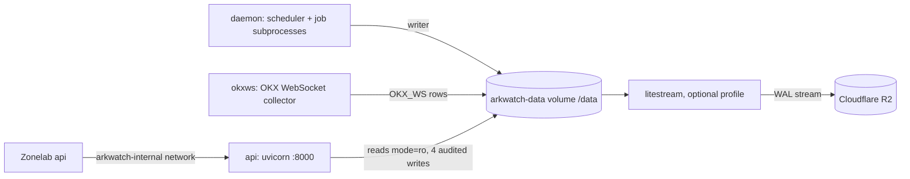

# ark-watch

A personal US macro monitoring engine: an automated data pipeline over 20+ free public sources, stored in SQLite, served by a read API to the Zonelab dashboard, with a morning brief and an alert watcher pushed to the phone via ntfy (Telegram and Discord optional).

Fork of [srikresna/ark-watch](https://github.com/srikresna/ark-watch) (MIT).

## What it does

- **Collects** 200+ economic series (FRED, NY Fed Markets API incl. SOMA per-CUSIP holdings, CME settlements and per-strike options, Treasury/fiscaldata auctions, regional Fed models, COT, prediction markets, an OKX WebSocket stream)
- **Computes** signals: Fed net-liquidity decomposition, SOMA maturity walls, options put/call ratios and OI walls, primary-dealer positioning, auction demand percentiles (45 years of history), inflation risk premium, recession triangulation (curve model / SPF survey / Sahm rule), a 6-pillar regime score, AMT playbook scenarios with a paper tracker and an evidence scorecard
- **Delivers** a morning brief and an alert watcher running every 60 seconds (macro and positioning triggers, credit vs equity divergence, playbook scenario fills and closes) to the phone via ntfy, Telegram or Discord

## Quickstart

```bash
uv sync --python 3.12   # locked, see uv.lock
cp .env.example .env      # add your FRED / FMP keys and NTFY_URL
python -m arkwatch daemon # runs the daily schedule
```

Or run single jobs (`python -m arkwatch help` lists every command):

```bash
python -m arkwatch harvest   # fetch all series
python -m arkwatch brief     # render the daily brief
python -m arkwatch verify    # data truth gate
```

## Layout

```
arkwatch/    fetchers (data sources), signals (computation), qa (jobs), senders, server (API), daemon
config/      series registry + signal thresholds (all YAML, provenance-commented)
tests/       1000+ offline tests, zero warnings policy, network blocked (loopback only)
fixtures/    captured API responses for parser tests
```

## Notes

- Keys go in `.env` only (see `.env.example`); never commit them.
- Some sources are unofficial CDN endpoints; every source is degradable, so one going down never breaks the brief. A multi-source job exits 1 (and pages) only on a broad outage: no success, or as many failures as successes. A single failing series is an ERROR row in `fetch_log`, visible in `GET /v1/health/fetchers`. The harvest skips the rest of a source after 3 consecutive network errors and stops at a 20-minute budget (both logged as SKIPPED and counted as failures).
- The regime score only uses fresh pillars: a pillar whose series is older than its cadence allows (daily 10 days, weekly 21, CPI 100) drops out and is marked stale; with fewer than 4 pillars the label is INSUFFICIENT DATA.
- Optional news source: set `ARGUS_TOKEN` (and `ARGUS_URL` if not the default) to add headlines from the self-hosted Argus MCP server; unset = SKIPPED.
- News text reaches an LLM for the sentiment radar. It is framed as untrusted data, off-schema output is dropped, and only official sources (Fed, BoE, Treasury, SEC, OilPrice RSS) can carry the OBSERVED evidence weight.
- This is a personal research tool, **not** investment advice.

### Polymarket crowd probabilities

`python -m arkwatch polymarket` (daemon: every hour at minute 20) reads the free Polymarket Gamma API (no key) and keeps the highest-volume active markets for the curated topics in `config/polymarket_queries.yaml` (Fed, recession, inflation, shutdown/debt ceiling, oil, gold, Bitcoin, S&P 500, Iran, Israel, Russia, China-Taiwan). Each market is a `computed_signals` row `polymarket:<slug>` whose value is the probability of the first outcome (usually "Yes", 0..1); question, outcomes, volume, end date and source URL sit in `inputs_json`. List them with `GET /v1/signals?prefix=polymarket:`. Markets below a topic's `min_volume` (default 50000 USD) are ignored.

### Kalshi market probabilities

`python -m arkwatch kalshi` (daemon: every hour at minute 25) reads Kalshi's public market data (no key) for `KXFEDDECISION`, `KXRECSSNBER` and `KXCPIYOY`: the nearest open event of each, its most-traded markets, stored as `kalshi:<ticker>` with the same topics as Polymarket. The price is the mid of a Yes quote no wider than 5 cents, else the last trade. Volume is in contracts (each pays $1), not USD. `GET /v1/odds` returns both venues with `venue` and `volume_unit`. Brier calibration stays Polymarket-only until Kalshi markets resolve after a stored snapshot.

### Phone push and dead-man switch

- Push: set `NTFY_URL` to a long random ntfy topic URL (for example `https://ntfy.sh/arkwatch-<random>`) and subscribe to the same topic in the ntfy app. Urgent alerts arrive at high priority, other macro alerts at the default, scenario fills and closes at low priority (listed without sound), the morning brief as a short summary linking to the dashboard. `NTFY_TOKEN` is only for protected or self-hosted topics.
- Delivery: briefs are queued for ntfy and Telegram, alerts broadcast to every configured channel (ntfy, Discord, Telegram). The daemon `send` job stays paused until at least one channel is configured; an unconfigured channel row ends as `skipped`, not `failed`. A failed send exits 1 (the daemon pages and retries); between 07:05 and 22:00 WIB the watch lane also retries a failed brief and delivers an API retry (`POST /v1/outbox/{id}/retry`) within a minute.
- Playbook scenarios: one push when a scenario fills (entry, stop, target, R:R) and one when a filled trade closes (outcome, exit, R). Keys are per scenario, so each event is sent once; only events within the last 12 hours of bar time are sent, so a first deploy does not replay the backlog.
- Credit vs equity divergence: HY OAS widening 50bp or more (IG 20bp) over five prints while ES1 (completed days) did not fall over the same dates; at most one alert per series per ISO week. Thresholds live in `config/params_signals.yaml` (`credit_div_*`).
- Dead-man switch: create a free healthchecks.io check (period 5 min, grace 10 min) and set `HEALTHCHECK_PING_URL` to its ping URL. The daemon pings it every 5 minutes while `healthcheck` passes and hits `<url>/fail` when a job fails, so a dead or hung daemon, a full disk or stopped backups page you by email.
- The topic URL, token and ping URL are secrets: keep them in the Easypanel environment, they never appear in logs.

## Deployment

One image, three roles (daemon, okxws, api), run as an Easypanel **Compose** service from `docker-compose.yml`.



The api has no public domain: Zonelab reaches it as `http://arkwatch-api:8000` on the external `arkwatch-internal` network. The `warp` SOCKS proxy has no auth and sits on its own `warp-net`, shared only with the daemon.

| Service | Command | Limits | Health |
|---|---|---|---|
| `daemon` | `python -m arkwatch daemon` | 1 GB, 1.2 CPU, 90 s stop grace | `healthcheck --heal`: main and lane heartbeats, DB readable, >= 3 GB free, newest backup < 36 h |
| `okxws` | `python -m arkwatch liquidations` | 128 MB, 0.25 CPU, 20 s stop grace | `healthcheck okxws --heal`: an `OKX_WS` trade batch within 5 min |
| `api` | `uvicorn arkwatch.server.app:app --workers 1` | 512 MB, 0.5 CPU | `GET /v1/health` via Python urllib |
| `litestream` | `litestream replicate` | 256 MB | profile `litestream`, opt-in |

Docker never restarts an `unhealthy` container on its own. `--heal` closes that gap: a main-loop or lane heartbeat (or the OKX stream) stale for 15 minutes sends SIGTERM to PID 1, and `restart: unless-stopped` brings the container back. Low disk or a missing backup stays unhealthy without restarting (a restart fixes neither); it stops the dead-man pings instead.

Everything persistent lives on the `arkwatch-data` volume at `/data`: `arkwatch.db`, daemon state and heartbeats, `logs/` (14 day retention) and `backups/`. The image sets `ARKWATCH_DATA_DIR=/data` and symlinks `/app/data` to `/data`, so modules with a hard-coded `data/arkwatch.db` land on the volume too.

Backups and retention (nightly at 23:30 WIB, `python -m arkwatch backup`):

- `VACUUM INTO` a temp file, `integrity_check` and row-count verification, then an atomic rename (a bad copy never replaces a good one), mode 600.
- Rotation: 7 dailies plus the first backup of each of the last 6 months. Every backup is a full copy on the same disk, so the count stays small; offsite copies are Litestream's job.
- Table retention, in 5000-row transactions: OKX orderbook snapshots, raw trade batches and trade events 7 days, liquidations 35 days, 1-minute flow and derivatives 180 days, CME options 400 days, 1-minute bars 3 days, `fetch_log` 180 days (the 5-minute `market` and `okx_market` rows 30 days).
- Sundays 23:45 WIB, `gdelt-retention --apply`: GDELT rows outside the current UTC week (a verified temporary snapshot is taken only when GDELT rows are deleted) and `market_news`, payloads and their NLP rows older than `MARKET_NEWS_RETENTION_DAYS` (90). Preview with `python -m arkwatch gdelt-retention`.

Egress: the daemon reaches hosts that block datacenter IPs (Yahoo 429, CFTC 403) through the `warp` SOCKS sidecar via `ARKWATCH_PROXY=socks5h://warp:9091`. Only hosts in `ARKWATCH_PROXY_HOSTS` (default `finance.yahoo.com,publicreporting.cftc.gov`, subdomains included) use it; CME and FRED stay direct because they fail through WARP. The legacy `ARKWATCH_YAHOO_PROXY` is still read as a fallback. Job subprocesses run without `ARKWATCH_API_KEY` and `LITESTREAM_*` in their environment.

First boot: on a brand-new volume (no `bootstrapped` marker in `daemon_state.json` and an empty `raw_observations`) the daemon runs the data chain once, sequentially (harvest, calendar, instruments sweep, fiscalx, nyfed ops, energy, surprise, cme, f2, fedsurvey, brief; never `send`), then sets the marker. A bootstrap interrupted by a redeploy resumes (`bootstrap_started` marker).

```bash
# local smoke test (needs Docker)
GIT_SHA=$(git rev-parse --short HEAD) ARKWATCH_API_KEY=dev docker compose up -d --build
docker compose exec daemon python -m arkwatch healthcheck
docker compose exec daemon python -c "import sqlite3; print(sqlite3.sqlite_version)"

# enable offsite replication once the R2 (or Backblaze B2) variables are set
docker compose --profile litestream up -d
```

> [!IMPORTANT]
> Secrets come only from the Easypanel environment (`ARKWATCH_API_KEY` is mandatory, the compose file refuses to start the api without it). Never commit `.env`.

<details><summary>Restore from a backup</summary>

1. Stop every process that opens the DB: `daemon`, `okxws` and `api` (the api has write routes).
2. Pick a file in `/data/backups/` (`arkwatch-YYYYMMDD.db`, verified at creation) and check it: `sqlite3 <file> "PRAGMA integrity_check"`.
3. Copy it over `/data/arkwatch.db` **as uid 10001** and remove the stale `/data/arkwatch.db-wal` and `-shm` of the old file. A root-owned copy leaves root-owned `-wal`/`-shm` files the app cannot write.
4. Start the services. The daemon re-asserts WAL mode and runs pending migrations; check `GET /v1/health` (`schema_version` equals `expected_schema_version`) and `python -m arkwatch healthcheck`.
5. Data newer than the backup is re-harvested by the next scheduled jobs where the source keeps history (FRED, CME a few days); the OKX stream, tracker state and alerts since the backup are lost.

Drill it once a quarter on a throwaway container from the newest backup.

</details>

<details><summary>Rotating a secret</summary>

| Secret | Set in | Also change | Restart |
|---|---|---|---|
| `ARKWATCH_API_KEY` | Easypanel `arkwatch` env | Zonelab `ZONELAB_ARKWATCH_KEY` (must be equal) | api, Zonelab |
| `NTFY_URL` (topic) | Easypanel `arkwatch` env | resubscribe in the ntfy app | daemon |
| `HEALTHCHECK_PING_URL` | Easypanel `arkwatch` env | healthchecks.io check | daemon |
| `NLP_API_KEY` | Easypanel `arkwatch` env | equals `forwardKey` in the `ofm-data` volume (`/data/settings.json`), regenerated when that volume is recreated | daemon |
| `FRED_API_KEY`, `FMP_API_KEY` | Easypanel `arkwatch` env | provider dashboard | daemon |
| `EASYPANEL_DEPLOY_URL` | GitHub repo secret | Easypanel deploy token | none |

</details>

<details><summary>Deploy-time checks</summary>

- [ ] The external network exists: `docker network create arkwatch-internal` (once per host).
- [ ] `sqlite3.sqlite_version` inside the image prints 3.53.4 (the build fails below 3.51.3).
- [ ] First boot: the healthcheck reports unhealthy until a job has created `/data/arkwatch.db`.
- [ ] Only one `daemon` replica: the OS lock on `/data/daemon.lock` makes a second one exit.

</details>

## API

Every `/v1` route except `/v1/health` needs the `x-arkwatch-key` header; write requests are refused before their body is read without it, and bodies over 16 KB are 413. Set `ARKWATCH_WRITE_KEY` (32+ chars) to require a separate key for the write routes, so the read key held by Zonelab cannot write. A write that meets the daemon's lock answers 503 `db_busy` (retry). Paginated lists return `{items, next_cursor}`; `/v1/cot/{contract}` and `/v1/health/fetchers` return plain lists, `/v1/odds` `{generated_at, items}` and `/v1/sentiment` a map keyed by asset. Errors are `{error, code, detail}`, except a `/v1/health` 503 which returns the health body with `status: down`. Responses are `Cache-Control: no-store`. All strings that come from third-party sources (news titles, summaries, quotes, market questions) are untrusted text for the consumer to escape; news URLs are http(s) only.

The full contract is the OpenAPI document: `python -m arkwatch.server.export_openapi` (32 paths, 34 operations, including the reads below plus series, signals, regime, levels, playbooks, calendar, news, sentiment, COT, prices, outbox, freshness and jobs). Writes are audited in `audit_log` and clear the API cache: `POST /v1/playbooks/{uid}/cancel`, `POST /v1/outbox/{id}/retry`, `PATCH /v1/series/{id}`, `POST /v1/jobs` (allowlisted job kinds, `x-arkwatch-actor` header).

Compute-heavy reads (regime, graph, scorecard, levels, sentiment, freshness, fetcher health) are cached for 45 seconds per argument set, one computation at a time.

Dashboard reads:

| Route | Returns |
|---|---|
| `GET /v1/alerts?status=&alert_type=&since=&cursor=&limit=` | alert rows, newest first, every status (limit max 200, `message` is plain text) |
| `GET /v1/alerts/summary` | counts by status and priority for the last 24h and 7d, plus `newest_triggered_at` |
| `GET /v1/briefs?limit=` | brief index: date, regime score, generated_at, chars |
| `GET /v1/briefs/latest`, `GET /v1/briefs/{YYYY-MM-DD}` | one brief with its raw markdown (404 when missing) |
| `GET /v1/odds` | Polymarket and Kalshi probabilities: question, probability, `venue`, `volume` with `volume_unit` (`usd` or `contracts`), end date, `url` |
| `GET /v1/health/fetchers` | per fetcher: latest `fetch_log` row (status, target, redacted error) and run/failure counts over 8 days. Needs the key, unlike `/v1/health` |
| `GET /v1/graph` | macro system graph: regime, 6 pillars, registry series, instruments, open playbooks, next-7d high/medium events |

The graph uses stored data only. Series are the pillar inputs plus the active registry series of the same block letter (block H has no pillar and is left out). Instruments link to the regime core because no asset to pillar mapping exists in config. Caps: 300 series, 60 scenarios, 50 events, so at most 446 nodes with the 29 instruments in `config/instruments.yaml`.

Playbook track record and open-book risk (computed from `playbook_scenarios`):

| Route | Returns |
|---|---|
| `GET /v1/playbook/scorecard?symbol=&horizon=&direction=&asset_class=` | per scenario type (`scenario_id`) x direction x horizon x asset class: n, scratches (0R), win rate among decisive trades with a Wilson 95% CI, expectancy R with a session-clustered bootstrap CI, avg win/loss R, profit factor, breakeven win rate, effective n, random-entry null, `sample_warning`, evidence `tier`; plus `overall` |
| `GET /v1/playbooks/{uid}` | also `scorecard`: the group of that scenario's own type, or null with `scorecard_reason` |
| `GET /v1/risk/book` | open scenarios (PENDING_TRIGGER, ACTIVE) with risk % of entry, reward to risk, age; counts by state, direction, asset class and cluster (`config/risk_clusters.yaml`); `r_at_stake` (1R per ACTIVE scenario, stated in the response); plain-text `flags` and advisory `veto_hints` |

How the tracker fills a scenario, so the record scores the stated setup: expansion and composite-value (CVA) scenarios fill on the first 5-minute **close** beyond the trigger, liquidity sweeps on a trade through the level followed by a close back (entry at that close, the trade starts with the next bar); rotations, single prints and naked-POC targets fill on a touch. Fills are paper fills on 5-minute bars: no spread, slippage or fees. Manual cancels (an operator-chosen exit) are not trades.

Tiers: `unvalidated` below 20 trades; `supported` needs 100+ trades, a Wilson lower bound above the breakeven win rate, an expectancy CI above 0, a beaten random-entry null (computed on a deterministic sample of at most 50 trades per group), at least 10 sessions and an effective n of 20; `rejected` needs 100+ trades and a Wilson upper bound below breakeven; everything else is `emerging`. Tiers describe tracked outcomes only. They are not a forecast and promise no future edge. Calibration is null because scenarios carry no claimed win probability. Asset class comes from the `class` field in `config/instruments.yaml` (unknown symbols are `other`).

## License

[MIT](LICENSE). Original work Copyright (c) 2026 srikresna; fork changes by PT Surya Inovasi Prioritas (SURIOTA). PDF parsing uses PyMuPDF (AGPL-3.0 or commercial); this repository is public source.

### Free LLM endpoint (optional)

The `ofm` compose service runs [dsh-our-free-model](https://github.com/Ebony-Vinyl/dsh-our-free-model)
(`packages/standalone`, MIT) so news NLP works without a paid key. It is third-party code: the image
is built from a pinned commit (not vendored here), one patch disables its sealed EAC path, and it runs
on its own network (`ofm-net`, shared only with the daemon) with no secrets, a read-only rootfs and
dropped capabilities. Its anonymous free lane presents itself as an OpenCode client, so it can be
throttled or closed by the upstream at any time; only public news text is sent. Host hardening for
the subnet (blocks the VPC, other Docker networks and the cloud metadata address):

```bash
iptables -N OFM-EGRESS
iptables -A OFM-EGRESS -d 172.31.77.0/24 -j RETURN
for n in 169.254.0.0/16 100.64.0.0/10 10.0.0.0/8 172.16.0.0/12 192.168.0.0/16; do iptables -A OFM-EGRESS -d $n -j DROP; done
iptables -A OFM-EGRESS -j RETURN
iptables -I DOCKER-USER 1 -s 172.31.77.0/24 -j OFM-EGRESS && netfilter-persistent save
```
